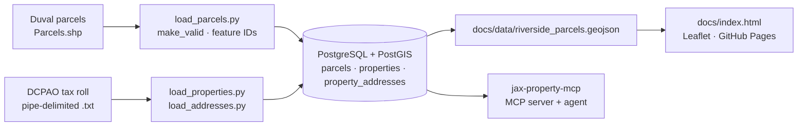

# jax-property-intelligence

[](https://scorecard.dev/viewer/?uri=github.com/knightchrism/jax-property-intelligence)

**Duval County parcels, assessor records and addresses, loaded into PostGIS and explorable on an interactive map.**

<p>
  <a href="LICENSE"></a>
  
  
  
  
</p>

**[Live demo: Riverside property explorer &rarr;](https://knightchrism.github.io/jax-property-intelligence/)**

The data foundation for [jax-property-mcp](https://github.com/knightchrism/jax-property-mcp), which puts an MCP server and AI agent on top of these tables.

## What it does

- **Profiles** the Duval parcel shapefile and the Property Appraiser pipe-delimited tax roll (`inspect_*.py`, `parse_*.py`).
- **Loads** parcels (geometry repaired with `make_valid`, counts of invalid/missing geometry printed before load; the source file is never modified), properties and addresses into PostGIS (`load_*.py`, schema in `sql/create_tables.sql`, EPSG:2236).
- **Publishes** a static Leaflet explorer of Riverside parcels with address, market and assessed value (`docs/`). No owner names are included.

## Architecture



## Quickstart (Windows)

Prerequisites: PostgreSQL with PostGIS and a `jax_property` database. Clone to a local folder such as `C:\dev\jax-property-intelligence` (keep projects out of OneDrive). Put source files in `data\raw\` (gitignored).

```powershell
cd C:\dev
git clone https://github.com/knightchrism/jax-property-intelligence.git
cd jax-property-intelligence
python -m venv .venv; .venv\Scripts\activate
pip install -r requirements.txt
# one-time, as a superuser: schema, then least-privilege roles (jax_loader builds tables, jax_reader is SELECT-only)
psql -U postgres -d jax_property -f sql\create_tables.sql
psql -U postgres -d jax_property -v ON_ERROR_STOP=1 -v loader_password=<strong-pw-1> -v reader_password=<strong-pw-2> -f sql\roles.sql
copy .env.example .env               # DB_USER=jax_loader + its password (never the postgres superuser)
python test_db_connection.py
python load_parcels.py               # PARCELS_PATH overrides .\data\raw\Parcels.shp
python load_properties.py
python load_addresses.py
cd docs; python -m http.server 8000  # map at http://localhost:8000/
```
Anything that only reads (notebooks, dashboards, the [jax-property-mcp](https://github.com/knightchrism/jax-property-mcp) server) should connect as `jax_reader`. Dependencies are pinned in `requirements.txt` (generated from `requirements.in`).

## AI / agent angle

This repo is the data layer. The agent work &mdash; MCP tools, a local Ollama agent and tool-choice evals &mdash; lives in [jax-property-mcp](https://github.com/knightchrism/jax-property-mcp).

## Tech stack

Python · GeoPandas · Shapely · SQLAlchemy + GeoAlchemy2 · psycopg 3 · PostgreSQL / PostGIS · Leaflet · OpenStreetMap · GitHub Pages

## Disclaimer

**Demo / testing only &mdash; not authoritative.** Values and parcel shapes are shown for demonstration. They are not a survey, title opinion, appraisal or legal determination, and may be out of date. Use the official Duval County Property Appraiser and City of Jacksonville records for any real decision. Not affiliated with either.

## Credits

- **Data:** Duval County Property Appraiser real estate tax roll (pipe-delimited, uncertified 09-01-2026) and City of Jacksonville / Duval County parcel GIS (public records). Basemap &copy; [OpenStreetMap](https://www.openstreetmap.org/copyright) contributors (ODbL).
- **Software:** GeoPandas, Shapely (BSD-3-Clause), SQLAlchemy (MIT), GeoAlchemy2 (MIT), psycopg (LGPL-3.0), python-dotenv (BSD-3-Clause), PostgreSQL (PostgreSQL License), PostGIS (GPL-2.0), [Leaflet](https://leafletjs.com) (BSD-2-Clause). Each keeps its own license.

## License

Code: MIT, see [LICENSE](LICENSE).
